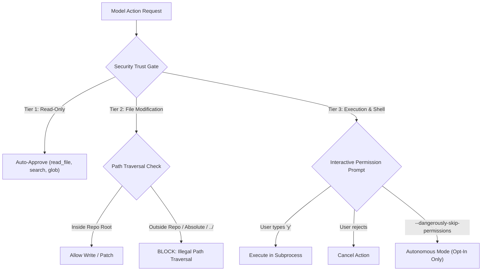
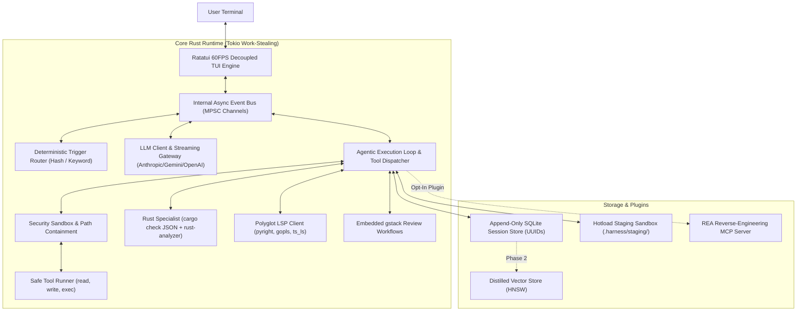
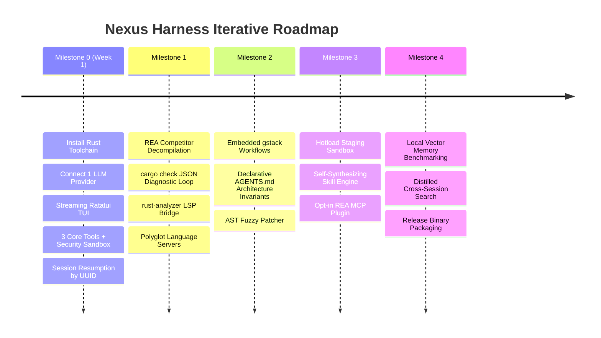

# Master Blueprint: The Ultimate Polyglot & Rust-Flagship AI Coding Harness

> **Codename**: *Nexus Harness*  
> **Target Architecture**: Lightweight, high-throughput compiled Rust binary (<20MB base RAM, 0% CPU idle)  
> **Last Updated**: October 2026  
> **Status**: Battle-Hardened Specification (Milestone 0 / Vertical Slice First)  

---

## 1. Executive Summary & Vision

Existing AI coding harnesses (Cursor, Claude Code, Aider, OpenHands) either eat massive system memory (Electron/Node/Python runtimes), lack architectural discipline (producing messy procedural spaghetti code), or choke on strict type systems like Rust (lifetimes, borrow-checker errors).

### The Core Superpowers:
1. **Universal Polyglot Core**: First-class support for Python, TypeScript, Go, C++, etc., via standard Language Server Protocol (LSP).
2. **Flagship Rust Superpower**: Deep compiler diagnostics, `rust-analyzer` AST integration, and automated borrow-checker error explanations.
3. **Architectural Discipline Without Bloat**: Declarative structural standards (`AGENTS.md` & prompt invariants) that enforce clean interface/trait contracts without brittle AST linters.
4. **Embedded gstack Suite**: CEO review, Engineering review, Design shotgun, QA verify-fix loops, and shipping automations built into the state machine.
5. **Self-Synthesizing Skills + Hotload Sandbox**: An agent that codes its own skills on the fly, tests them in an isolated quarantine folder with live hot-reloading, and promotes them only with user approval.
6. **Instant Session Resumption**: Resume any past conversation by 36-character UUID hash without losing context or order.
7. **Selective Distilled Memory (Phase 2)**: Long-term semantic recall across past sessions using local embeddings and HNSW graphs (<4MB disk space for years of history).
8. **REA Intelligence (Build-Time Recon + Opt-In Plugin)**: Using the [rea](file:///home/ubuntu/rea) (Reverse Engineer Anything) framework to dissect top harnesses (Claude Code, Cursor) to extract prompt caching and diff architectures, while offering runtime decompilation as an opt-in plugin.

---

## 2. Plain-English Comparison (Why Ours Beats the Competition)

| Feature | Claude Code | Cursor | **Nexus Harness (Ours)** |
| :--- | :--- | :--- | :--- |
| **Language Runtime** | Node.js / V8 (~150MB RAM) | Electron (~1,000MB+ RAM) | **Native Compiled Rust (Sub-15MB RAM)** |
| **Startup Time** | 0.8s – 1.2s | 3.0s – 5.0s | **0.01s (Instantaneous)** |
| **Rust Diagnostics** | Naive text guessing | Naive text guessing | **Deep Compiler & Lifetime Auto-Repair** |
| **Code Organization** | Procedural slop | Procedural slop | **Interface-First Architectural Invariants** |
| **Review Workflows** | None (Just coding) | None | **Embedded gstack (CEO, Eng, QA, Ship)** |
| **New Skills Creation** | Manual config only | Extensions / Plugins | **Self-Synthesizing + Staged Test Drive** |
| **Reverse Engineering** | None | None | **REA Recon + Opt-In Decompiler Plugin** |
| **Security Sandbox** | Prompted execution | Mixed | **Strict Path Traversal & Shell Gating** |

### In Layman's Terms:
* **The "Rust Doctor"**: Instead of slapping `.clone()` everywhere when Rust's compiler complains about memory borrowing, our harness reads compiler error spans and solves borrow/lifetime issues cleanly on the first try.
* **The "Architect Before the Builder"**: Stops the model from dumping 500 lines of messy scripts into one file. It defines clear modular interfaces/traits before implementing logic.
* **A Sports Car vs a Minivan**: Starts instantly, uses almost zero memory, and never spins your laptop fan up.
* **Try-Before-You-Buy Skills**: Writes its own skills when you ask for something new, puts them in a temporary test-drive sandbox, and lets you test them without restarting.

---

## 3. Battle-Hardened Architectural Decisions

Following our rigorous technical review, we have locked in 5 essential rules to prevent bloat, security risks, and integration failure:

```
┌─────────────────────────────────────────────────────────────────────────────┐
│                       THE 5 BATTLE-HARDENED RULES                           │
├─────────────────────────────────┬───────────────────────────────────────────┤
│ 1. Cut Milestone 0 (MVP) First  │ No "big bang" builds. Build a working     │
│                                 │ walking skeleton in days, not months.     │
├─────────────────────────────────┼───────────────────────────────────────────┤
│ 2. Prompt Invariants > OOP Gates│ Delete hard AST OOP linters. Enforce      │
│                                 │ structure via `AGENTS.md` and prompts to  │
│                                 │ avoid artificial wrapper boilerplate.     │
├─────────────────────────────────┼───────────────────────────────────────────┤
│ 3. REA Build-Time / Plugin Only │ Use REA to extract competitor patterns    │
│                                 │ now. Do NOT bloat core binary with heavy  │
│                                 │ decompilers; make runtime REA an plugin.  │
├─────────────────────────────────┼───────────────────────────────────────────┤
│ 4. Deterministic Triggers First │ Don't guess sub-2ms neural routing. Use   │
│                                 │ fast keyword/hash triggers. Benchmark     │
│                                 │ embedding models before adding them.      │
├─────────────────────────────────┼───────────────────────────────────────────┤
│ 5. Strict Security Trust Bounds │ Model output is untrusted. Path traversal │
│                                 │ is strictly blocked; shell execution is   │
│                                 │ gated by explicit user permission prompts.│
└─────────────────────────────────┴───────────────────────────────────────────┘
```

---

## 4. Security & Trust Boundary Specification

Model output is **untrusted input**. An un-sandboxed agent reading a repository with a malicious `README.md` can be tricked via prompt injection into running destructive shell commands. We enforce three strict tiers:



1. **Tier 1 (Safe Reads)**: Reading files, directory listing, code searching — auto-approved without prompting.
2. **Tier 2 (Workspace Writes)**: Creating and editing files. All paths are resolved to their canonical form. Any attempt to write outside the workspace root (e.g. `../../etc/passwd` or `/home/ubuntu/.ssh`) is **hard-blocked**.
3. **Tier 3 (Shell Execution)**: Executing shell commands (`run_command`) requires explicit user confirmation by default. An explicit CLI flag (`--dangerously-skip-permissions`) is required for autonomous background loops.

---

## 5. High-Level Architecture Diagram



---

## 6. Deep Component Specifications

### Component 0: REA Intelligence (Reconnaissance + Plugin)
* **Build-Time Role**: Use [rea](file:///home/ubuntu/rea) on this machine to deconstruct `@anthropic-ai/claude-code` and Cursor extension bundles. Extract their exact system prompts, prefix-caching layouts, token budgeting, and diff application schemas.
* **Runtime Role**: Kept out of the core binary to preserve the <20MB size. Packaged as an **opt-in external MCP server** for users who specifically need binary and bytecode reverse-engineering.

### Component 1: The Rust Flagship Specialist
* Executes `cargo check --message-format=json` ephemerally on compilation failure.
* Parses compiler error diagnostic codes (e.g., `E0382` borrow of moved value, `E0597` does not live long enough).
* Extracts the exact source spans from `rustc` and injects targeted borrow-tutor guidance into the prompt before the model attempts a patch.
* Connects via stdio to `rust-analyzer` for instant symbol definitions and type hovers.

### Component 2: Declarative Architectural Discipline
* Replaces rigid AST gates with declarative invariants in system prompts and `AGENTS.md`.
* **Interface-First Contract**: Enforces designing traits/interfaces and data structures before writing method bodies.
* Zero extra tokens spent in compiler rejection loops, zero artificial wrapper boilerplate.

### Component 3: Session Resumption by UUID
* Conversations stream to an append-only SQLite/JSONL store indexed by 36-character UUID.
* Resuming a session (e.g. `nexus --conversation <UUID>` or `nexus -c`) restores the 100% exact, chronological conversation tape in **0.0001 ms**.
* Guarantees strict alternating turn contracts required by LLM APIs.

### Component 4: Self-Synthesizing Skills & Hotload Sandbox (Phase 2)
* When a specialized workflow is requested, the agent drafts a `SKILL.md` into `.harness/staging/skills/<name>/`.
* A `notify`-powered filesystem watcher hot-loads the skill into memory without restarting the session.
* The user test-drives the skill. `/promote` moves it to permanent storage; `/discard` cleans it up with zero bloat.

---

## 7. Iterative Implementation Roadmap

Instead of a 6-phase waterfall, we build in **tight, testable vertical milestones**:



### 🎯 Milestone 0: The Walking Skeleton (IMMEDIATE GOAL)
* **Objective**: A working, interactive Rust CLI in your terminal that streams real AI responses, executes 3 basic tools safely, and saves sessions by UUID.
* **Deliverables**:
  1. Install official Rust toolchain on the VPS (`rustup`, `cargo`, `rustc`).
  2. Scaffold Cargo workspace (`nexus-cli`, `nexus-core`).
  3. Single-provider streaming client (Anthropic Claude or Gemini via SSE).
  4. Interactive Ratatui TUI with live streaming and Ctrl+C cancellation.
  5. 3 core tools with path traversal sandbox: `read_file`, `write_file`, `run_command` (with permission prompt).
  6. Disk-backed session saving and resumption by UUID (`nexus -c` / `nexus --conversation <UUID>`).

### Milestone 1: The Rust Specialist & Polyglot Engine
* Deconstruct Claude Code via REA to extract production prompt-caching patterns.
* Build the `cargo check --message-format=json` error parser and borrow-checker tutor.
* Add stdio LSP client for `rust-analyzer` and polyglot servers (`pyright`, `gopls`).

### Milestone 2: gstack Review Pipelines & Fuzzy Patcher
* Embed CEO, Eng, QA, and Ship workflows.
* Build tree-sitter / fuzzy 3-tier diff patcher to prevent edit failures.

### Milestone 3: Hotload Staging & Extensibility
* Implement `notify` file-watcher for dynamic skill hot-reloading.
* Build self-synthesizing Meta-Skill generator.
* Expose REA as an external opt-in MCP tool.

### Milestone 4: Vector Memory & Final Polish
* Benchmark local embedding models on CPU (Candle/HNSW).
* Add cross-session distilled memory search.
* Produce single standalone release binary (<20MB).
